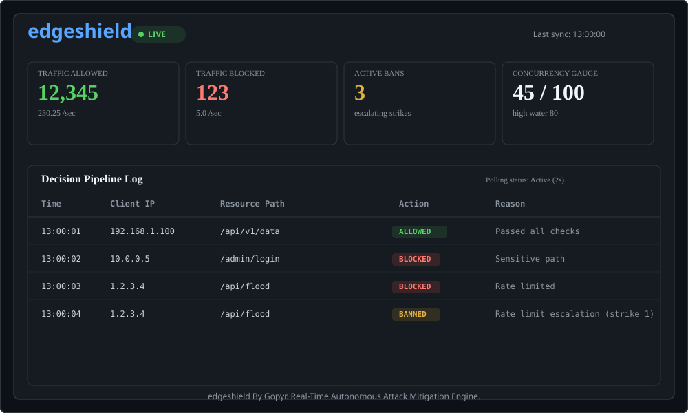

# edgeshield

edgeshield adalah reverse proxy shield lokal untuk melindungi layanan berskala kecil dari serangan Layer 7 dan overload. Ia berada di depan aplikasi Anda dan memfilter lalu lintas sebelum sampai ke origin. Fitur utamanya: rate limiting per-IP, auto-ban dengan eskalasi, pembatasan konkurensi, slowloris timeout, dan engine aturan sederhana. Tanpa dependensi, berjalan di Node 18+.

edgeshield adalah setengah dari portofolio pertahanan: GP-1 mengukur perilaku layanan di bawah beban, edgeshield menjaga layanan tetap hidup saat bebannya hostile.

## Melindungi dari

| Jenis Serangan | Pertahanan | Status Code |
|---|---|---|
| Botnet flood dari banyak IP | Token bucket per-IP (burst + refill) | 429 |
| Penyalahgunaan berulang dari satu IP | Auto-ban dengan tier eskalasi (1m → 5m → 15m) | 429 |
| Connection flood / Slowloris | `headersTimeout` + `requestTimeout` pada socket proxy | 408/close |
| Path/product abuse (scraping, admin probing) | Engine aturan: blokir berdasarkan path, method, user-agent, IP, CIDR | 403 |
| Oversized bodies / URL patologis | `maxBodyBytes`, `maxPathLen` | 413 / 414 |
| Beban paralel berlebihan pada origin | Concurrency gauge (batas in-flight) | 503 |
| Probing langsung ke origin | Shield adalah satu-satunya entri; origin bind loopback | n/a |

## Instalasi

```bash
npm install -g .
# atau jalankan tanpa instalasi global
node src/cli.mjs --config config.example.json
```

## Penggunaan

```bash
edgeshield # Jalankan dengan default: target 127.0.0.1:3000, listen 0.0.0.0:8080
edgeshield --config config.json
edgeshield --target 127.0.0.1:3000 --port 8080    # default minimal
edgeshield --block-ip 1.2.3.4 --config config.json # blokir manual sementara
```

Jalankan layanan target di `127.0.0.1:3000`, arahkan shield ke sana, dan rutekan lalu lintas lewat port shield. Origin terikat pada loopback, jadi probing langsung gagal di lapisan jaringan.

## Dashboard Live

Saat berjalan, buka `http://localhost:8080/__shield`. Dashboard bertema gelap ini meminta data tiap 2 detik tanpa aset eksternal, dan menampilkan konter lalu lintas diizinkan/diblokir, ban aktif, puncak konkurensi, byte yang diteruskan, serta tabel keputusan terbaru lengkap dengan alasan tiap permintaan diblokir.



## Konfigurasi

Lihat [`config.example.json`](config.example.json) untuk contoh lengkap. Aturan mendukung `ip`, `cidr`, `path` (exact atau sufiks `*`), `method`, `userAgent` (regex), dan `query` (key atau key=value). Aturan yang cocok pertama yang dieksekusi.

## Cara Kerja

1. `Shield.evaluate()` berjalan berurutan: cek ban → aturan → panjang path → ukuran body → token bucket per-IP → window global → concurrency gauge.
2. Pelanggaran rate-limit memicu `BanManager.strike(ip)`: pelanggaran berturut-turut dalam `forgetMs` menaikkan durasi ban lewat tingkatan.
3. Permintaan yang diizinkan diproksi ke target dengan `http.request`; error upstream mengembalikan 502.
4. `/__shield` dan `/__shield/stats` dilayani shield itu sendiri, tidak pernah diproksi.

## Batasan Desain

edgeshield dibuat untuk layanan tunggal, dengan overhead sekecil mungkin. Batasan berikut adalah pilihan yang disengaja:

-   Proses tunggal dengan state di memori saja. Latensi rendah, footprint kecil, pas untuk VPS atau ditempel di samping aplikasi backend kecil.
-   Tidak ada terminasi TLS, HTTP/2, atau proxying WebSocket. Codebase tetap ramping dan mudah diaudit.
-   `trustProxy` mempercayai header `X-Forwarded-For` secara langsung, jadi Anda yang memutuskan asumsi keamanannya di lingkungan proxy.
-   Throttling dan blocking berdasarkan _bentuk_ lalu lintas (rate, ukuran, pola path), bukan inspeksi konten payload. Inspeksi konten itu tugas WAF, bukan shield ringan.

## Pengembangan

```bash
npm test        # unit: limiters, rules
node test/integration.mjs   # end-to-end: jalankan shield, serang, verifikasi
```

## Lisensi

[MIT License](LICENSE)
